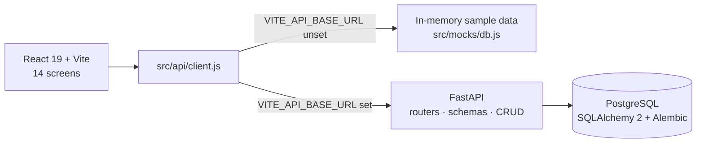

<table>
<tr>
<td width="64%">

### Client Desk

**A CRM for a woodcraft business.** Orders, logistics, inventory and outreach on one dark, dense desk —
every screen answers *"what needs me today?"* before it shows you a table.

</td>
<td>

<br>
<br>
<br>
<br>
<br>
<a href="LICENSE"></a>

</td>
</tr>
</table>

<p>
  <a href="#features"></a>
  <a href="#screenshots"></a>
  <a href="#design"></a>
  <a href="#architecture"></a>
  <a href="#getting-started"></a>
  <a href="#roadmap"></a>
</p>

### Release notes

**v0.2.0** · *October 2026*
- **Full stack connected** — the frontend reads and writes PostgreSQL through FastAPI, and the stock rule runs server-side in a single transaction.
- **New frontend** — 14 screens, a per-screen colour system, and sample data so it runs without a backend.

**First backend** · *August 2026*
- Leads, organisations, customers and emails, with a CRUD layer and Alembic migrations.

---

## Features

| | |
|---|---|
| **Overview** | Money in flight by stage, delivered revenue, return rate, new leads, unopened email — and the orders that need a decision next. |
| **Orders & Returns** | One table, two views. A return is the same row with `kind = 'return'`, so refunds, exchanges and modifications stay linked to the original sale. |
| **Logistics** | A board from *Processing* to *Delivered*, for deliveries and returns alike, with due dates, priority and "not in stock, needs making" flags. |
| **Inventory** | Stock levels with a server-side stock rule: placing an order checks and decrements stock inside a single transaction. |
| **Leads, Customers, Organisations** | The sales pipeline and account records, tagged by acquisition source (website, Instagram, Facebook, direct). |
| **Emails & Campaigns** | Outreach tracking with priority and open status. |
| **Insights & Statistics** | Prospects with full carts, closed-won sales and why things came back; a fulfilment funnel, lead times, and revenue by source, category, wood and account. |
| **Todo & People** | Tasks linked to the records they're about, and the team behind them. |

## Screenshots

<table>
  <tr>
    <td width="50%"></td>
    <td width="50%"></td>
  </tr>
  <tr>
    <td align="center"><sub><b>Logistics</b> — deliveries and returns on one board</sub></td>
    <td align="center"><sub><b>Orders</b> — filterable, sortable, editable in a drawer</sub></td>
  </tr>
  <tr>
    <td width="50%"></td>
    <td width="50%"></td>
  </tr>
  <tr>
    <td align="center"><sub><b>Insights</b> — who's about to buy, and what came back</sub></td>
    <td align="center"><sub><b>Statistics</b> — funnel, lead times and revenue breakdowns</sub></td>
  </tr>
</table>

<details>
<summary><b>Overview and Inventory</b></summary>
<br/>

<br/><br/>

</details>

## Design

Each screen owns a hue — Orders green, Logistics violet, Insights magenta — that tints only the *chrome*
(sidebar, header, hover states) and never a data cell. Status and priority use their own ordered colour
ramps, and blue always means "you can act on this". Because the encodings never share a place, a coloured
thing is never ambiguous. The full system — tokens, tint ladder, grain, glow and lift — is documented in
[`frontend/DESIGN-SPEC.md`](frontend/DESIGN-SPEC.md) so it can be ported to other projects.

## Architecture



The frontend reads everything through one client module. Leave `VITE_API_BASE_URL` unset and it runs
on sample data that mirrors the backend's seed, so the demo works with no server at all. Set it and every
screen reads and writes the real database through FastAPI.

## Getting started

**Frontend only** (sample data, no backend needed)

```bash
cd frontend
npm install
npm run dev                          # http://localhost:5173
```

**Full stack**

```bash
# 1. Backend
python -m venv .venv && source .venv/bin/activate    # Windows: .venv\Scripts\activate
pip install -r requirements.txt
cd backend/app
cp .env.example .env                 # set DATABASE_URL to your Postgres database
alembic upgrade head                 # create the tables
python seed.py                       # optional: load the woodcraft sample data
uvicorn main:app --reload            # http://127.0.0.1:8000/docs

# 2. Frontend, pointed at the API
cd ../../frontend
cp .env.example .env.local           # VITE_API_BASE_URL=http://127.0.0.1:8000
npm run dev
```

## Project structure

```
backend/app/
├── main.py            # FastAPI app, CORS, routers
├── models/            # SQLAlchemy models with Postgres enums
├── schemas/           # Pydantic request/response models
├── crud/              # data access, incl. the transactional stock rule
├── routers/           # one router per entity
├── alembic/           # migrations
└── seed.py            # sample data
frontend/src/
├── api/               # one module per entity + client.js (the swap point)
├── mocks/             # sample data used without a backend
├── components/        # layout, ui and data components (DataTable, FormDrawer, …)
├── pages/             # one per screen
└── lib/               # formatting, domain vocabulary, colour encoding
```

More detail on the frontend, its data layer and what the backend still needs is in
[`frontend/README.md`](frontend/README.md).

## Roadmap

- Authentication and password hashing
- A `/stats` endpoint instead of browser-side aggregation
- Server-side search, sorting, filtering and pagination
- Multi-item orders

## License

[MIT](LICENSE) © Barnak Roy Nandy
